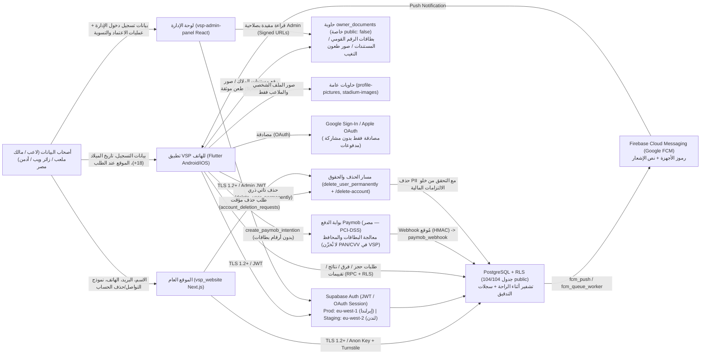

# مخطط تدفق البيانات الشخصية (Data Flow Diagram — DFD) — مشروع VSP

**تاريخ آخر تحديث:** 2026-11-28  
**المرجع القانوني:** قانون حماية البيانات الشخصية المصري رقم **151 لسنة 2020** ولائحته التنفيذية الصادرة بقرار وزير الاتصالات وتكنولوجيا المعلومات رقم **816 لسنة 2025** (صدر في **1 نوفمبر 2025** ونُفّذ من **2 نوفمبر 2025**).

---

## 1. المخطط التدفقي الشامل (End-to-End DFD)

---

## 2. مصفوفة مسارات البيانات وحدود النقل والتخزين

| المسار | نقطة الإدخال | نوع البيانات المنقولة | مقر الاستضافة / الوجهة | الأساس القانوني والضابط التقني | تصنيف الالتزام |
|---|---|---|---|---|---|
| **1. التسجيل والتحقق من العمر (`18+`)** | `VSP.App` (Email / Google / Apple) | الاسم، البريد، الهاتف، تاريخ الميلاد | `Supabase` (`eu-west-1` إنتاج / `eu-west-2` Staging) | `vsp_is_adult_date_of_birth` + `enforce_vsp_minimum_age` + موافقة `terms_accepted_at` | `[STATUTORY_OBLIGATION]` (مواد 2، 6، 14 قانون 151/2020) |
| **2. وثائق الهوية KYC للملاك** | شاشة توثيق المالك + `owner_documents` | صورة الرقم القومي / مستندات الملكية (بيانات حساسة) | حاوية `owner_documents` (`public: false`) | سياسة `owner_documents_owner_manage` (`folder[1] = auth.uid()` أو `is_admin_or_cofounder`) + Signed URLs | `[STATUTORY_OBLIGATION]` + `[LICENSE_REQUIRED]` (بيانات حساسة) |
| **3. الموقع الجغرافي وصور طعن التغيب** | `Geolocator` + `no_show_dispute_service.dart` | الإحداثيات اللحظية + صورة السيلفي عند تعذر GPS الدقيق | `owner_documents/${uid}/disputes/...` + جدول `reports` / `bookings` | إذن نظام التشغيل الاختياري + مسار حاوية خاصة `owner_documents` (أُصلح بحذف `getPublicUrl` في `2026-11-28`) | `[STATUTORY_OBLIGATION]` (أمن وتقليل البيانات) |
| **4. المدفوعات والاسترداد** | `create_paymob_intention` / `paymob_webhook` / `process_paymob_refund` | معرّف الحجز، المبلغ، رقم هاتف الفوترة، مرجع العملية | **Paymob مصر** (خادم محلي للدفع) + سجل `transactions` في Supabase | صفر تخزين لبيانات البطاقات (PAN/CVV) لدى VSP + تحقق HMAC + فحص `require_active_admin_actor` للمطابقة | `[STATUTORY_OBLIGATION]` + اتفاقية معالج بيانات `[LEGAL_REVIEW_REQUIRED]` |
| **5. الإشعارات الفورية (Push)** | `fcm_push` / `fcm_queue_worker` | رمز FCM للجهاز + عنوان ونص الإشعار | Google Firebase Cloud Messaging (دولي) | أذونات الإشعارات الاختيارية + إبقاء النصوص خالية من البيانات المالية الحساسة | `[RECOMMENDED_PRACTICE]` + تصريح نقل عبر الحدود `[LICENSE_REQUIRED]` |
| **6. حذف الحساب وطلبات الويب (DSAR)** | `delete_user_permanently` / صفحة `/delete-account` | معرف المستخدم، البريد/الهاتف في `account_deletion_requests` | `Supabase PostgreSQL` | منع الحذف الجزئي عند وجود مديونية أو حجز نشط + أتمتة مراجعة طلبات الويب | `[STATUTORY_OBLIGATION]` (المادة 4 حقوق صاحب البيانات) |

---

## 3. حدود الفصل التنظيمي في الـ DFD
- **المتحكم بالبيانات (Data Controller):** كيان مشروع VSP (يُستكمل اسمه القانوني وسجله التجاري قبل الإطلاق `[LEGAL_REVIEW_REQUIRED]`).
- **المعالجون الخارجيون (Data Processors):** Supabase (الاستضافة وقواعد البيانات)، Paymob (بوابة الدفع المصرية)، Google/Firebase (OAuth وFCM)، Cloudflare Turnstile (حماية نماذج الويب).
- **الاستضافة خارج مصر:** يتطلب نقل بيانات المستخدمين من مصر إلى `eu-west-1` (إيرلندا) وإلى خدمات Google/Firebase استخراج **تصريح نقل بيانات عبر الحدود** من مركز حماية البيانات الشخصية (PDPC) طبقًا للمواد (14–16) من القانون 151/2020 ولائحته التنفيذية رقم 816/2025 `[LICENSE_REQUIRED]`.
